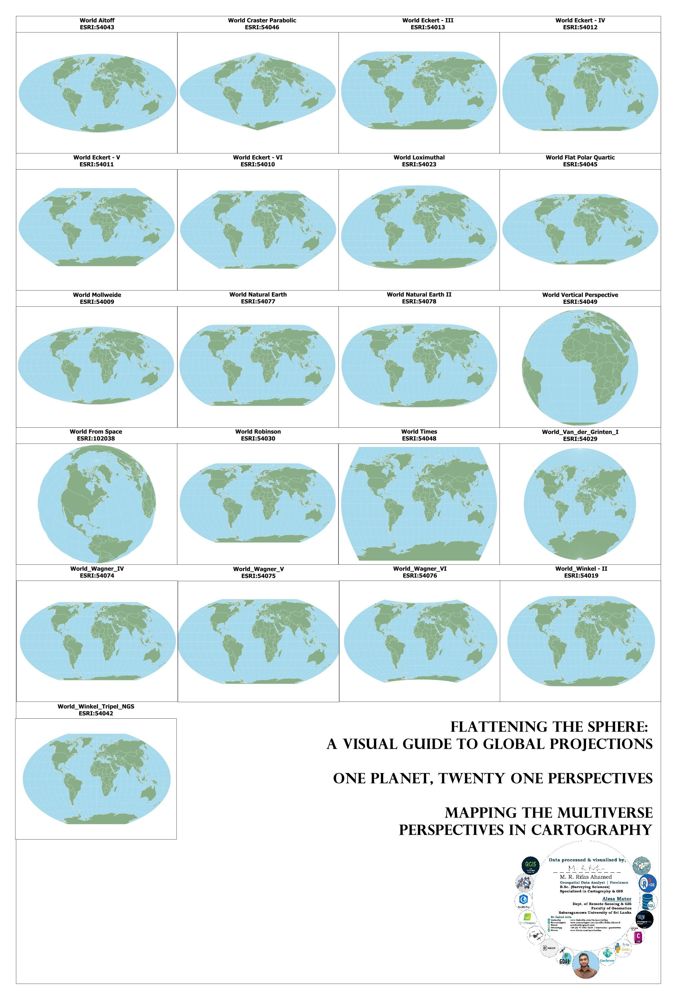

<!--
CHECKLIST FOR THIS PAGE (copy this file for each new project):
- [x] Replace [YOUR PROJECT TITLE] with your project title
- [x] Replace the hero image with your own (add to docs/assets/images/)
- [x] Update the Overview section
- [x] Update the Methods & Tools section
- [x] Update the Key Findings section
- [x] Update the Links section
- [ ] Add a card for this project on docs/projects/index.md
- [ ] Add a nav entry in mkdocs.yml
-->

# Flattening the Sphere: A Visual Guide to 21 World Map Projections

## Overview

A personal portfolio and reference project: one poster that shows the same world map in all 21 world projections ESRI provides in QGIS, each labelled with its name and ESRI code. I started it because I wanted to understand world coordinate systems and find the best-looking ways to present global GIS data. It also explains the choice of World Van der Grinten I in my FIFA 2026 and BRICS maps.

- **Study Area:** Global  
- **Duration:** 10 August 2026 (single-day project)  
- **Role:** Solo project (personal, not for a client)  
- **Status:** Completed

---

## Methods & Tools

**Data Sources**

- [Natural Earth 1:10m Admin 0 – Countries](https://www.naturalearthdata.com/downloads/10m-cultural-vectors/10m-admin-0-countries/): country boundaries
- QGIS CRS Catalog: names and codes of the world projections
- [ESRI list of supported map projections](https://pro.arcgis.com/en/pro-app/latest/help/mapping/properties/list-of-supported-map-projections.htm): reference for projection properties

**Processing Steps**

1. Loaded the Natural Earth country boundaries and applied simple styling.
2. Listed every world projection that ESRI provides in the QGIS CRS Catalog (21 in total).
3. Added 21 map items to a single QGIS Print Layout, each set to a different CRS.
4. Labelled each map with its projection name and ESRI code.
5. Added the title and credits block, and compiled everything into one poster.

**Tools Used**

| Tool | Purpose |
|------|---------|
| QGIS | Loading and styling the country boundaries |
| QGIS CRS Catalog | Finding the 21 ESRI world projections |
| QGIS Print Layout | One map item per projection, composed into a single poster |
| Natural Earth | Country boundary data |

---

## Key Findings

The 21 projections fall into four groups, based on the properties they preserve.

### 1. Equal-area (6)

These keep the relative size of areas true, but distort shapes, especially near the edges.

| Projection | ESRI code |
|------------|-----------|
| World Craster Parabolic | ESRI:54046 |
| World Eckert IV | ESRI:54012 |
| World Eckert VI | ESRI:54010 |
| World Flat Polar Quartic | ESRI:54045 |
| World Mollweide | ESRI:54009 |
| World Wagner IV | ESRI:54074 |

### 2. Compromise: pseudocylindrical (9)

These balance distortion of area, shape and distance rather than preserving any one property perfectly.

| Projection | ESRI code |
|------------|-----------|
| World Eckert III | ESRI:54013 |
| World Eckert V | ESRI:54011 |
| World Loximuthal | ESRI:54023 |
| World Natural Earth | ESRI:54077 |
| World Natural Earth II | ESRI:54078 |
| World Robinson | ESRI:54030 |
| World Wagner V | ESRI:54075 |
| World Wagner VI | ESRI:54076 |
| World Winkel II | ESRI:54019 |

### 3. Compromise: other forms (4)

These are also compromise projections, built differently (modified azimuthal, circular or cylindrical).

| Projection | ESRI code |
|------------|-----------|
| World Aitoff | ESRI:54043 |
| World Times | ESRI:54048 |
| World Van der Grinten I | ESRI:54029 |
| World Winkel Tripel NGS | ESRI:54042 |

### 4. Perspective (2)

These show the Earth as if seen from space, so only one hemisphere is visible at a time.

| Projection | ESRI code |
|------------|-----------|
| World From Space | ESRI:102038 |
| World Vertical Perspective | ESRI:54049 |

### Observations

- **Antarctica gives the clearest test of distortion.** It is stretched into a huge band along the bottom in World Times, and fans out with radiating lines in Van der Grinten I.
- **Equal-area maps look alike at a glance**, but their outlines differ: the pointed Craster Parabolic, the rounded Mollweide and Eckert IV, and the flat-topped Eckert VI.
- **Perspective projections cannot show the whole world.** World From Space is centred on North America and World Vertical Perspective on Africa, so each hides the opposite side.
- **Van der Grinten I** shows every country in one rounded view. That is why I used it for the FIFA 2026 and BRICS maps, where all countries had to appear together.

### Other world projections not in this poster

QGIS also offers other world-scale projections, so the 21 above are a subset of what is possible. Examples include Mercator, Plate Carrée (equidistant cylindrical), Miller Cylindrical, Sinusoidal, Gall Stereographic, Behrmann, Eckert I and II, Winkel I, Hammer-Aitoff, Goode Homolosine and Bonne. I may add them in a future version.

---

## Links

[View Natural Earth Data](https://www.naturalearthdata.com/downloads/10m-cultural-vectors/10m-admin-0-countries/){ .md-button }
[ESRI Supported Map Projections](https://pro.arcgis.com/en/pro-app/latest/help/mapping/properties/list-of-supported-map-projections.htm){ .md-button }